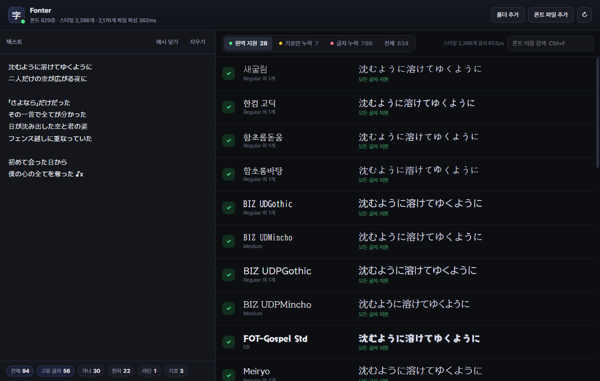
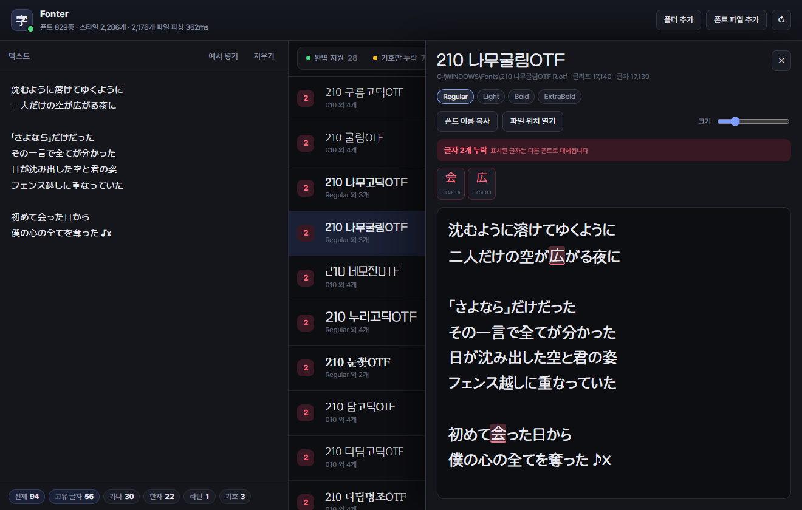

# Fonter

가사·자막을 붙여넣으면, 내 PC의 폰트 중 **그 글자를 전부 그릴 수 있는 폰트**를 즉시 찾아주는 Windows 프로그램입니다.
일본어·중국어 가사처럼 한자가 섞인 텍스트에서 "이 폰트에 이 글자가 있나?"를 하나씩 확인할 필요가 없습니다.

*Paste text, instantly see which installed fonts can render every character in it. Built for CJK lyrics and subtitles.*




## 사용법

1. [Releases](../../releases/latest)에서 `Fonter.exe`를 받아 실행합니다. 설치 과정 없는 단일 실행 파일입니다.
2. 왼쪽에 텍스트를 붙여넣습니다. `.txt` `.lrc` `.srt` `.ass` 파일을 창에 끌어다 놓아도 됩니다.
3. 오른쪽에 결과가 입력과 동시에 나옵니다.
   - **완벽 지원** — 모든 글자를 지원
   - **기호만 누락** — 글자·숫자는 전부 있고 `♪` 같은 기호만 없음
   - **글자 누락** — 없는 글자가 있음 (누락이 적은 순으로 정렬)
4. 폰트를 누르면 해당 폰트로 전체 텍스트를 미리 보고, 누락 글자와 유니코드 값을 확인할 수 있습니다.

설치하지 않은 폰트도 검사할 수 있습니다. **폴더 추가 / 폰트 파일 추가** 버튼을 쓰거나 폰트 파일·폴더를 창에 끌어다 놓으세요.

Windows 10/11, WebView2 런타임 필요(Windows 11에는 기본 포함). 서명되지 않은 실행 파일이라 처음 실행할 때 SmartScreen 경고가 뜰 수 있습니다.

## 빈 글리프까지 걸러냅니다

폰트의 문자표(`cmap`)에 글자가 등록돼 있다고 해서 실제로 그려지는 것은 아닙니다. 일부 한글 폰트는 한자나 가나 영역 전체를 **아무것도 그리지 않는 빈 글리프**에 연결해 둡니다. 문자표만 보는 검사기는 이런 폰트를 "지원"으로 판정하고, 실제 영상에서는 글자가 공백으로 나옵니다.

Fonter는 글리프의 윤곽선 데이터까지 확인해서 이런 글자를 누락으로 처리합니다.

| 폰트 | 문자표상 글자 수 | 실제로 그려지는 글자 수 |
| --- | ---: | ---: |
| 나눔명조OTF Regular | 17,559 | 12,488 (한자 전부 빈 글리프) |
| 나눔휴먼OTF ExtraBold | 12,411 | 3,359 (가나·한자 등 빈 글리프) |

판정 결과는 fontTools로 독립 계산한 값과 대조해 검증했습니다(`bench/verify_coverage.py`, 시스템 폰트 무작위 204개 파일 기준 223개 스타일 전부 일치).

## 왜 빠른가

측정 환경: 16스레드 CPU, 시스템 폰트 2,176개 파일(4.6GB, 2,286개 스타일), 파일 캐시가 채워진 상태.

| 방식 | 전체 폰트 읽기 |
| --- | ---: |
| 이전 버전: Python fontTools, 파일 전체를 메모리로 읽음 | 약 71초 (300개 표본 32.7ms/파일로 환산) |
| Rust, 파일 전체 읽기, 1스레드 | 약 1.7초 |
| Rust, 메모리 매핑, 1스레드 | 약 1.4초 |
| **Rust, 메모리 매핑, 병렬 (첫 실행)** | **약 0.2초** |
| **캐시된 인덱스 (두 번째 실행부터)** | **약 26ms** |

| 조회 방식 (고유 글자 145개 × 2,286개 스타일) | 한 번 검사 |
| --- | ---: |
| 정렬된 범위 이진 탐색 | 약 3.1ms |
| 페이지 비트셋, 1스레드 | 약 0.45ms |
| **페이지 비트셋, 병렬 (채택)** | **약 0.13ms** |

핵심은 세 가지입니다.

- **필요한 테이블만 읽기** — 파일을 메모리 매핑하고 `cmap`·`name`·`OS/2`·글리프 오프셋 표만 건드립니다. 20MB짜리 CJK 폰트도 몇 페이지만 읽습니다.
- **병렬 파싱 + 디스크 캐시** — 파일별로 병렬 처리하고, 결과를 경로·크기·수정 시각 기준으로 캐시합니다. 다음 실행부터는 바뀐 파일만 다시 읽습니다.
- **3단 페이지 비트셋** — 지원 글자를 평면 → 256자 페이지 표 → 256비트 페이지로 저장해, "이 폰트에 이 글자가 있나"가 배열 접근 세 번으로 끝납니다. 전체 폰트 검사가 1ms 안쪽이라 타이핑할 때마다 다시 계산합니다.

글자 → 폰트 집합의 역색인도 실험했습니다. "완벽 지원 여부"만 구할 때는 1µs 미만으로 가장 빠르지만, 폰트별 누락 글자 수를 세어 순위를 매기려면 결국 같은 양의 작업이 필요해서 채택하지 않았습니다.

직접 재보려면:

```bash
cargo run --release -p fonter-core --example bench
```

```bash
python bench/baseline_fonttools.py 300
```

## 빌드

Rust(stable, MSVC)가 필요합니다. 프런트엔드는 빌드 단계가 없는 정적 파일입니다.

```bash
cargo build --release -p fonter --features custom-protocol
```

결과물은 `target/release/fonter.exe`입니다.

## 구조

- `core/` — 폰트 탐색, cmap·빈 글리프 판정, 캐시, 인덱스, 조회 (Rust 라이브러리)
- `app/` — Tauri 2 셸: 명령, 미설치 폰트 미리보기용 프로토콜
- `ui/` — 화면 (HTML/CSS/JS, 프레임워크 없음)
- `bench/` — 벤치마크 기준선과 정확도 검증 스크립트
